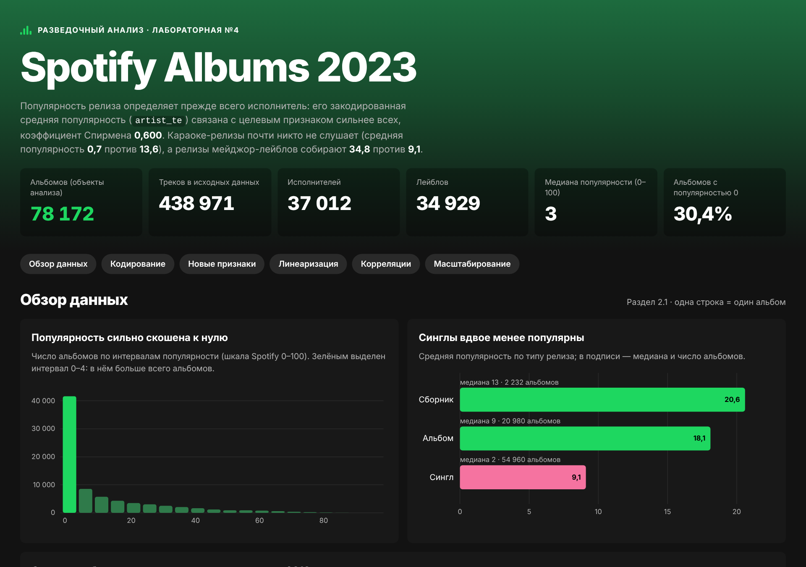

# Spotify Albums 2023 — EDA

Интерактивный дашборд по лабораторной работе №4 «Разведочный анализ данных» (дисциплина ОАД, МГТУ им. Н.Э. Баумана).
Набор данных — Spotify Albums Data 2023, очищенный в ЛР №3: 438 971 трек, 78 172 альбома.
Целевой признак — популярность альбома `album_popularity` по шкале Spotify 0–100.



## Что на дашборде

| Раздел | Пункт методички | Содержимое |
|---|---|---|
| Обзор данных | 2.1 | распределение популярности, популярность по типу релиза, популярность и число альбомов по годам, 15 крупнейших лейблов |
| Кодирование | 2.2 | способ кодирования каждого категориального признака и обоснование |
| Новые признаки | 2.3 | популярность с флагом и без него, популярность по доле треков с feat., проверка шести гипотез |
| Линеаризация | 2.4 | графики «до» и «после» для четырёх преобразований, сравнение коэффициентов |
| Корреляции | 2.5–2.6 | Пирсон и Спирмен с популярностью для каждого признака, корреляционная матрица с переключателем |
| Масштабирование | 2.7 | диапазоны после StandardScaler, MinMaxScaler, RobustScaler и таблица статистик |

У графиков есть подсказки при наведении. Страница адаптирована под телефон.

## Как открыть

Откройте `index.html` в браузере двойным щелчком: сервер не нужен, данные подключены как скрипт `assets/data.js`.
Без интернета страница тоже работает, только вместо шрифта Figtree будет системный.

## Публикация на GitHub Pages

1. Положите папку `dashboard/` в репозиторий и отправьте на GitHub.
2. В репозитории откройте **Settings → Pages**, в **Build and deployment** выберите **Deploy from a branch**, ветку `main` и папку `/ (root)`.
3. Через минуту дашборд будет доступен по адресу `https://<логин>.github.io/<репозиторий>/dashboard/`.

Если дашборд лежит в корне репозитория, адрес будет `https://<логин>.github.io/<репозиторий>/`.

## Структура

```
dashboard/
├── index.html              разметка страницы
├── assets/
│   ├── style.css           стили (тёмная тема)
│   ├── app.js              отрисовка графиков и таблиц на d3
│   ├── data.js             агрегированные данные (генерируется build_data.py)
│   └── d3.v7.9.0.min.js    библиотека d3 (локальная копия)
├── build_data.py           пересборка data.js из ноутбука lab4_eda.py
└── docs/preview.png        скриншот для README
```

## Как пересобрать данные

Все числа на странице посчитаны ноутбуком `lab4_eda.py`. Если ноутбук изменился, обновите `assets/data.js`:

```bash
cd dashboard
python build_data.py                      # по умолчанию берёт ../lab4_eda.py
python build_data.py --notebook путь/к/lab4_eda.py
```

Нужны те же библиотеки, что и для ноутбука (marimo, pandas, numpy, scipy, scikit-learn, matplotlib, seaborn), и файл `spotify_albums_2023_clean.csv` рядом с ноутбуком.
Сам CSV (≈ 90 МБ) в репозиторий класть не обязательно: странице он не нужен.

## Источники и лицензии

- Данные: Spotify Albums Data 2023 (Kaggle), предобработка — ЛР №3.
- [d3.js](https://d3js.org) v7.9.0, лицензия ISC, © Mike Bostock.
- Шрифт [Figtree](https://fonts.google.com/specimen/Figtree), SIL Open Font License.

Учебный проект. Не связан со Spotify AB и не одобрен ею.
